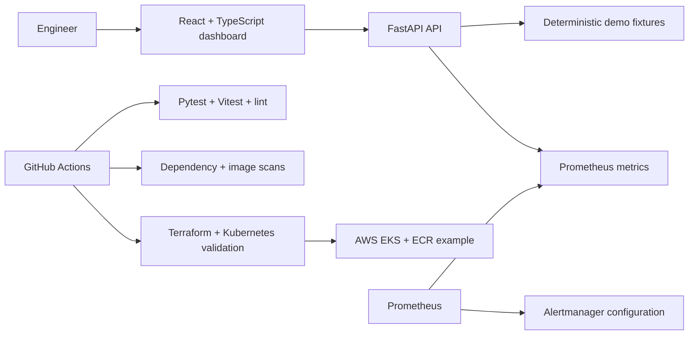

# QlaudOps Cloud-Native DevOps Automation & Self-Healing Platform

**Automate every deployment. Observe every service. Recover before users notice.**

QlaudOps is a portfolio-ready DevOps command center with a React/TypeScript operations dashboard, a FastAPI service, deterministic demo workflows, hardened container configuration, Kubernetes deployment examples, Terraform AWS examples, and CI security checks.

## What works now

- Responsive command center with 17 working navigation destinations, global search (`Ctrl/⌘ K`), environment selector, charts, service health, pipeline history, alerts, and cost visualizations.
- FastAPI health/readiness, dashboard, service, pipeline, alert, deployment, cost, backup, integration and Prometheus metrics endpoints. OpenAPI is available at `/docs`.
- Demo Lab for a passing pipeline, isolated deterministic test failure (build/deploy blocked), alert acknowledgement, safe recovery and confirmation-gated rollback.
- Pytest API coverage and Vitest/Testing Library component coverage.
- Multi-stage, non-root Docker build; hardened Compose example; restricted Kubernetes workload with probes, requests/limits, autoscaling, disruption budget and ingress-scoped NetworkPolicy.
- Terraform EKS control-plane and ECR examples using an existing VPC/subnets, plus GitHub Actions checks for tests, lint, audits, image scan, Terraform and Kubernetes manifests.

## Architecture



## Execution modes and data boundaries

The dashboard starts in **Demo** mode. Its service metrics, cloud costs, cluster inventory, and release history are deterministic fixtures and are labeled accordingly. The API integration status reports that AWS and cluster credentials are not configured. A working local API is shown as connected; that does not mean a cloud system is connected. Demo pipeline outcomes and recovery are simulations: no shell commands, Docker daemon operations, Kubernetes API operations, or AWS calls are performed by the demo endpoints. The rollback flow requires a second confirmation and only records a simulated result.

Alert acknowledgements mutate process memory only and reset when the API restarts. There is no user database, authentication, authorization, or durable audit store. This is suitable for a local portfolio demonstration, not a multi-tenant production deployment. Put an authenticated gateway and persistent audit/event store in front of any real operational controls.

## Prerequisites

- Python 3.11+
- Node.js 22 and npm
- Optional: Docker Desktop, kubectl + a local cluster, Terraform 1.6+, AWS CLI/credentials for a separately reviewed plan

## Local development

Terminal 1, API:

```powershell
cd backend
python -m venv .venv
.\.venv\Scripts\Activate.ps1
python -m pip install -r requirements-dev.txt
uvicorn app.main:app --reload --port 8000
```

Terminal 2, frontend:

```powershell
cd frontend
npm ci
npm run dev
```

Open <http://localhost:5173>. Vite proxies `/api`, `/health`, and `/ready` to port 8000. API docs: <http://localhost:8000/docs>. No credentials are needed for demo mode.

## Automated checks

```powershell
cd backend
python -m pytest -q
python -m compileall -q app
python -m pip install bandit pip-audit
bandit -q -r app
pip-audit -r requirements-dev.txt

cd ../frontend
npm ci
npm run lint
npm test
npm run build
npm audit --audit-level=high
```

`scripts/validate.ps1` runs the local checks, Terraform formatting, and Kubernetes rendering.

## Docker and Compose

```powershell
docker compose config
docker compose up --build
```

Visit <http://localhost:8000>. The image runs as UID 10001, drops Linux capabilities, uses a read-only root filesystem and has a readiness health check. Building the image requires npm registry access for the frontend dependencies and PyPI access for Python packages.

## Kubernetes

Build and tag an image accessible to your cluster, then:

```powershell
kubectl kustomize k8s/overlays/development
kubectl apply -k k8s/overlays/development
kubectl -n qlaudops rollout status deployment/qlaudops
kubectl -n qlaudops port-forward service/qlaudops 8000:80
```

The base manifests assume ingress and monitoring namespaces named `ingress-nginx` and `monitoring`; adapt the NetworkPolicy selectors to your cluster. Configure the optional `qlaudops-secrets` Secret through an external secret manager when required. The sample currently does not consume cloud credentials. The HPA requires metrics-server. Image tag `dev` must be built and loaded/pushed before deployment.

## Terraform and AWS

`terraform/modules/eks` is an example that expects a pre-existing VPC and private subnets. It creates an EKS control plane, IAM control-plane role, security group, and immutable ECR repository with scan-on-push. It does not create node groups, VPC networking, a remote state backend, or application ingress. The demo variable defaults are conspicuous placeholders.

```powershell
terraform -chdir=terraform/environments/demo init -backend=false
terraform -chdir=terraform/environments/demo validate
terraform -chdir=terraform/environments/demo plan
```

The plan needs real VPC/subnet IDs and AWS credentials to be useful. **Do not run `terraform apply` for the portfolio demo.** EKS control planes, EC2 nodes, networking and related AWS services can incur charges. Before a real use, configure S3 state encryption/versioning and state locking, least-privilege IAM, private networking, node groups, log retention, budget alerts, and a peer-reviewed change gate. No resources are created by CI.

## CI/CD and release gates

`.github/workflows/ci.yml` runs API checks, frontend lint/tests/build, Bandit, pip-audit, npm audit, Terraform format/validate, Kubernetes lint, Docker build and Trivy scan. The production environment job is a placeholder gated to manual dispatch on `main`; it does not publish an image or deploy. Configure GitHub environment approvals, registry authentication via OIDC, immutable image tags, provenance, and a reviewed deploy/rollback workflow before enabling publishing. Do not add long-lived cloud keys to repository secrets.

## Monitoring and alerting

- `GET /metrics` exposes Prometheus request metrics.
- `monitoring/prometheus/prometheus.yml` scrapes the Kubernetes service; `alerts.yml` includes API availability and p95 latency rules. For a local Compose network, change the API target to `qlaudops:8000`.
- `monitoring/grafana/provisioning/` provisions a Prometheus datasource and the starter dashboard in `monitoring/grafana/dashboards/`.
- `monitoring/alertmanager/alertmanager.yml` defines grouping defaults without notification credentials. Add a real authenticated receiver, Grafana dashboards, retention, and network/TLS configuration before using it outside a local demo.
- API logs are JSON on stdout. OpenTelemetry tracing/export is not wired yet.

## Demo scenarios

1. **Pass:** choose Run pipeline. Validation and test stages pass; later build/deploy are marked simulated and the API health endpoint is checked.
2. **Fail:** in the Demo Lab select Trigger failure. The deterministic test stage fails, while build and deploy show blocked.
3. **Recover:** select Recover service. A simulated recovery is recorded; no Kubernetes operation occurs.
4. **Rollback:** open Deployments and choose Rollback latest, then explicitly confirm. A simulated rollback health result is recorded.
5. **Acknowledge alert:** use Acknowledge on an alert; the API marks it acknowledged in memory.

## Security considerations

- Never put credentials in `.env`, source, image layers, Terraform state checked into Git, or browser storage. `.env.example` contains no secrets.
- The sample API is unauthenticated, uses in-memory fixtures, and permits browser access from configured CORS origins. Keep it local or place it behind authenticated access control before exposing it.
- Kubernetes disables service-account token mounting, uses a restricted pod security namespace, non-root UID, seccomp RuntimeDefault, read-only root filesystem, dropped capabilities, resource bounds and NetworkPolicy.
- CI scans Python dependencies, npm dependencies, Python code and the container image. Review scanner output; no scan can prove a deployment is secure.
- The Terraform example keeps EKS API private, but its module requires a security review, a proper node role/group, subnet tagging, access entries, log configuration and state backend before use.

## Validation status

Local validation completed for this project version: Python compile and 6 pytest checks; Bandit; pip-audit; frontend ESLint, 5 Vitest checks, production build and npm audit; Docker image build and container smoke requests for `/`, `/health`, `/metrics`, and the blocked-failure pipeline; Compose configuration; Terraform format and `validate`; Kustomize rendering; and Prometheus/Grafana/Alertmanager/workflow YAML plus Grafana dashboard JSON parsing.

No live Kubernetes server validation, AWS plan/apply, GitHub Actions run, external alert delivery, or Playwright end-to-end browser run was performed. The local Kubernetes API endpoint was unavailable to this shell. The browser visual check was interrupted by a user-input event, so only HTTP-level container checks verified the served dashboard.

## Troubleshooting

- **Dashboard says API offline:** start Uvicorn on port 8000; check `http://localhost:8000/ready` and browser network access.
- **npm ci fails:** use Node 22 and rerun from `frontend`; lockfile is committed.
- **Docker daemon unavailable:** start Docker Desktop, verify `docker info`, then retry Compose.
- **Pods do not become ready:** ensure the image is available to the cluster, metrics-server is installed for HPA, and the ingress namespace matches the NetworkPolicy.
- **Terraform init fails:** check registry/network access; use `-backend=false` for validation. Plan only with valid AWS region, VPC/subnets and read permissions.

## Known limitations and next steps

Live AWS, Kubernetes workloads, registry publishing, release deployment, database persistence, auth/RBAC, backup execution, OpenTelemetry and browser end-to-end tests are not enabled. Next steps for production are persistent audit storage, identity integration, read-only live connectors, approved write workflows, secrets management, real alert routing, and cost-bounded AWS infrastructure review.
